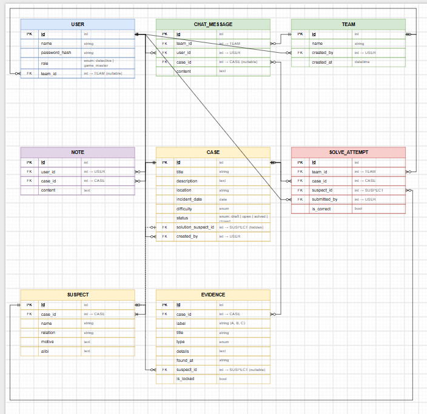

# Casebook

## Overview
Casebook is a full-stack multiplayer detective game where every player is a detective. The Game Master publishes cases with a briefing, suspects, and evidence, and hides the real culprit. Detectives join teams, study the case file, keep private notes, discuss clues in team chat, and submit the suspect they believe is guilty. The server checks each answer against the hidden solution, and the first correct answer marks the case as solved. Guests can browse the list of cases, but must sign in to open case files and play.

## Screenshots

## Technologies Used

## User Stories
1. As a player, I want to sign up with a name and password, so that I can play.
2. As a detective, I want to log in and out, so that my account stays secure.
3. As a detective, I want to create or join a team, so that I can investigate with friends.
4. As a detective, I want to browse open cases, so that I can choose one.
5. As a detective, I want to read a case's suspects and evidence, so that I can work out who did it.
6. As a detective, I want to submit our suspect, so that we find out if we solved the case.
7. As the Game Master, I want to create, edit and delete cases, so that players have new mysteries.
8. As the Game Master, I want to lock and unlock evidence, so that the case unfolds step by step.
9. As a detective, I want to keep private notes, so that I can track my thinking.
10. As a detective, I want to chat with my team, so that we can share clues.

## Modules
1. **Users** – sign up, sign in, roles (Detective, Game Master), and teams
2. **Cases** – case files, suspects, evidence, and solving, plus Game Master management
3. **Investigation** – private notebook and team chat

## Database Design

## Routes

| Method | Route | Description | Access |
|--------|-------|-------------|--------|
| GET | `/` | Home page | Public |

### Auth (`/auth`)
| Method | Route | Description | Access |
|--------|-------|-------------|--------|
| GET | `/auth/sign-up` | Sign-up form | Public |
| POST | `/auth/sign-up` | Create account | Public |
| GET | `/auth/sign-in` | Sign-in form | Public |
| POST | `/auth/sign-in` | Sign in | Public |
| GET | `/auth/sign-out` | Sign out | Signed in |

### Teams (`/team`)
| Method | Route | Description | Access |
|--------|-------|-------------|--------|
| GET | `/team` | List teams | Signed in |
| POST | `/team` | Create a team | Signed in |
| PUT | `/team/:tID/join` | Join a team | Signed in |
| PUT | `/team/leave` | Leave current team | Team member |

### Cases (`/case`)
| Method | Route | Description | Access |
|--------|-------|-------------|--------|
| GET | `/case` | List cases (optional `?status=` and `?difficulty=` filters) | Public |
| GET | `/case/:cID` | View case file (locked evidence and solution hidden) | Signed in |
| POST | `/case/:cID/solve` | Submit a suspect as the culprit | Team member |
| GET | `/case/new` | New case form | Game Master |
| POST | `/case` | Create case | Game Master |
| GET | `/case/:cID/update` | Edit case form | Game Master |
| PUT | `/case/:cID` | Update case | Game Master |
| DELETE | `/case/:cID` | Delete case with its suspects and evidence | Game Master |

### Suspects (`/suspect`)
| Method | Route | Description | Access |
|--------|-------|-------------|--------|
| POST | `/suspect/:cID` | Add a suspect to case `cID` | Game Master |
| PUT | `/suspect/:sID` | Edit suspect | Game Master |
| DELETE | `/suspect/:sID` | Delete suspect | Game Master |

### Evidence (`/evidence`)
| Method | Route | Description | Access |
|--------|-------|-------------|--------|
| POST | `/evidence/:cID` | Add evidence to case `cID` | Game Master |
| PUT | `/evidence/:eID` | Edit evidence | Game Master |
| PUT | `/evidence/:eID/toggle-lock` | Lock or unlock evidence | Game Master |
| DELETE | `/evidence/:eID` | Delete evidence | Game Master |

### Notes (`/note`)
| Method | Route | Description | Access |
|--------|-------|-------------|--------|
| POST | `/note/:cID` | Add a note to case `cID` | Signed in |
| PUT | `/note/:nID` | Edit own note | Note owner |
| DELETE | `/note/:nID` | Delete own note | Note owner |

### Chat (`/chat`)
| Method | Route | Description | Access |
|--------|-------|-------------|--------|
| GET | `/chat` | Team chat page | Team member |
| POST | `/chat` | Send a message (also broadcast with Socket.io) | Team member |
| DELETE | `/chat/:mID` | Delete own message | Message owner |

## Features

## Future Enhancements

## Extra Features
