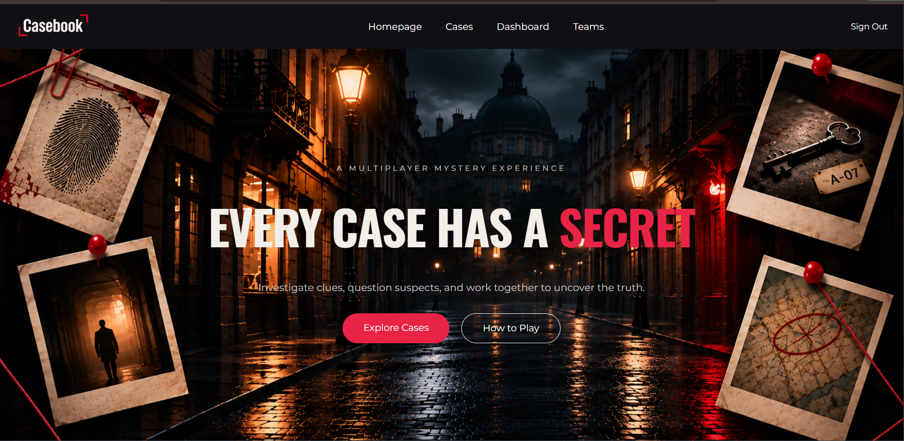
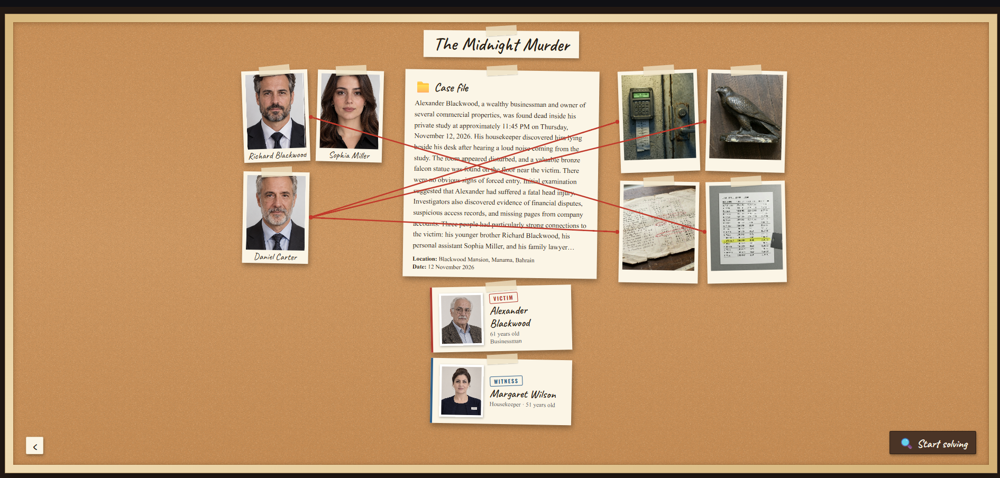
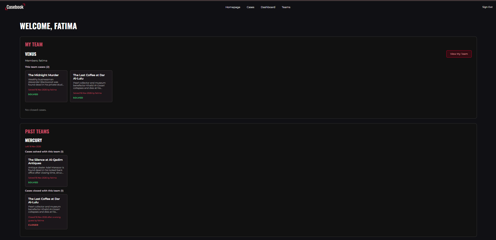

# Casebook Frontend

## Overview

Casebook is a full-stack multiplayer detective game where every player is a detective. An admin (the Game Master) publishes cases with a briefing, a victim, witnesses, suspects and evidence, and hides the real culprit.

How to play:

1. **Sign up and sign in.** Guests can browse the list of open cases, but they must sign in to play.
2. **Create or join a team**, or play alone.
3. **Open a case.** The case board shows the case file, victim, witnesses, suspects and evidence as cards you can drag around.
4. **Investigate.** Question suspects about their relation to the victim, their motive, their alibi and each piece of evidence, and watch their body language. Connect clues on the board with strings, write notes and talk in the team chat. Notes, board changes and chat messages appear live for the whole team.
5. **Accuse a suspect.** Each team gets as many attempts as half the number of suspects (rounded up), and can't accuse the same suspect twice. When the case is solved or the attempts run out, the real culprit is revealed.
6. **Track your progress** on the dashboard, which shows solved and failed cases.

## Live Application

- **Frontend:** https://casesbook.netlify.app
- **Backend API:** https://casebook-bg5e.onrender.com
- **Backend Repository:** https://github.com/FatimaAlsakin/project3-backend

## Screenshots

### Home Page



### Case Board



### Dashboard



## Technologies Used

- React 19
- Vite
- React Router
- Axios
- Socket.IO Client
- react-draggable (moving cards and notes on the board)
- react-xarrows (strings between items on the board)
- chatscope chat UI kit (team chat and suspect questioning)
- react-textarea-autosize
- Notyf (toast notifications)
- CSS

## Features

- User registration and login with JWT, stored in `localStorage` and cleared when it expires
- Protected routes that redirect to the sign-in page
- Admin dashboard and sidebar for the Game Master
- Admins can create, edit and delete cases, including the victim, witnesses, suspects and evidence, with image uploads
- Players only see open cases; admins see draft and closed cases too
- Drag-and-drop investigation board with cards for the case, victim, witnesses, suspects and evidence
- Strings to connect clues on the board
- Suspect questioning with body language for each answer
- Notes on the board, shared with your team
- Team chat for each case
- Live updates with Socket.IO: board, notes, chat and new evidence
- Teams: create, join and leave a team, and see your team's members
- Solve attempts with a limited number of guesses, and a reveal of the culprit at the end
- Dashboard of solved and failed cases
- Toast notifications for success and error messages

## Project Structure

```text
src/
├── assets/
├── components/
│   ├── AdminSidebar.jsx
│   ├── BoardNotes.jsx
│   ├── CaseBoard.jsx
│   ├── LiveCase.jsx
│   ├── Navbar.jsx
│   ├── TeamChat.jsx
│   └── useSharedBoard.js
├── pages/
│   ├── case/
│   ├── sloveAttempt/
│   ├── Teams/
│   ├── AdminDashboard.jsx
│   ├── Dashboard.jsx
│   ├── EditNote.jsx
│   ├── Homepage.jsx
│   ├── SigninPage.jsx
│   └── SignupPage.jsx
├── services/
├── socket/
│   └── socket.js
├── styles/
├── utils/
│   └── notify.js
├── App.jsx
└── main.jsx
```

| Folder       | Purpose                                                     |
| ------------ | ----------------------------------------------------------- |
| `components` | Reusable pieces: navbar, admin sidebar, case board, chat, notes |
| `pages`      | One component for each route                                |
| `services`   | Axios calls to the backend, one file for each resource      |
| `socket`     | Socket.IO client connection                                 |
| `styles`     | CSS for each page and component                             |
| `utils`      | Toast notification helper                                   |

## Getting Started

### Prerequisites

Install the following before running the project:

- Node.js

The backend API has to be running. See the [backend repository](https://github.com/FatimaAlsakin/project3-backend) for how to set it up.

## Installation

### 1. Clone the repository

```bash
git clone https://github.com/FatimaAlsakin/project3-frontend.git
cd project3-frontend
```

### 2. Install dependencies

```bash
npm install
```

### 3. Create the environment file

Create a `.env` file in the root directory:

```env
VITE_BACK_END_SERVER_URL=http://localhost:3000
VITE_SOCKET_URL=http://localhost:3000
```

### 4. Start the development server

```bash
npm run dev
```

Go to:

```text
http://localhost:5173
```

## Application Routes

| Route              | Page                                    | Access                      |
| ------------------ | --------------------------------------- | --------------------------- |
| `/`                | Home page                               | Public                      |
| `/sign-up`         | Sign-up page                            | Public                      |
| `/sign-in`         | Sign-in page                            | Public                      |
| `/cases`           | All cases                               | Public                      |
| `/case/:cId`       | Case board                              | Public (sign in to solve)   |
| `/case/:cId/solve` | Solve the case (question and accuse)    | Authenticated               |
| `/case/create`     | Create a case                           | Admin                       |
| `/case/:cId/edit`  | Edit a case                             | Admin                       |
| `/dashboard`       | Player dashboard or admin dashboard     | Authenticated               |
| `/teams`           | All teams                               | Authenticated               |
| `/teams/create`    | Create a team                           | Authenticated               |
| `/teams/my-team`   | My team and its members                 | Authenticated               |
| `/note/:nId/edit`  | Edit a note                             | Note owner                  |

## User Stories

1. As a player, I want to sign up with a username and password, so that I can play.
2. As a detective, I want to sign in and out, so that my account stays secure.
3. As a detective, I want to create or join a team, so that I can investigate with friends.
4. As a detective, I want to browse open cases, so that I can choose one.
5. As a detective, I want to read the case file, victim, witnesses, suspects and evidence, so that I can work out who did it.
6. As a detective, I want to question suspects and watch their body language, so that I can spot who is lying.
7. As a detective, I want to arrange cards and connect clues on a board, so that I can see how everything fits together.
8. As a detective, I want to write notes my team can see, so that we can share our thinking.
9. As a detective, I want to chat with my team, so that we can discuss clues.
10. As a detective, I want to accuse a suspect, so that we find out if we solved the case.
11. As a detective, I want to see my solved and failed cases, so that I can track my progress.
12. As the Game Master, I want to create, edit and delete cases, suspects and evidence, so that players have new mysteries.

## Future Enhancements

- Search and filter cases by difficulty or title
- A leaderboard of teams
- Hints that unlock as the investigation goes on
- Better support for small screens

## Team Members

| Name           | GitHub                                            |
| -------------- | ------------------------------------------------- |
| Fatima Alsakin | [FatimaAlsakin](https://github.com/FatimaAlsakin) |
| Ruqaya         | [GitHub profile]                                  |
| Rayan          | [GitHub profile]                                  |

## Credits
